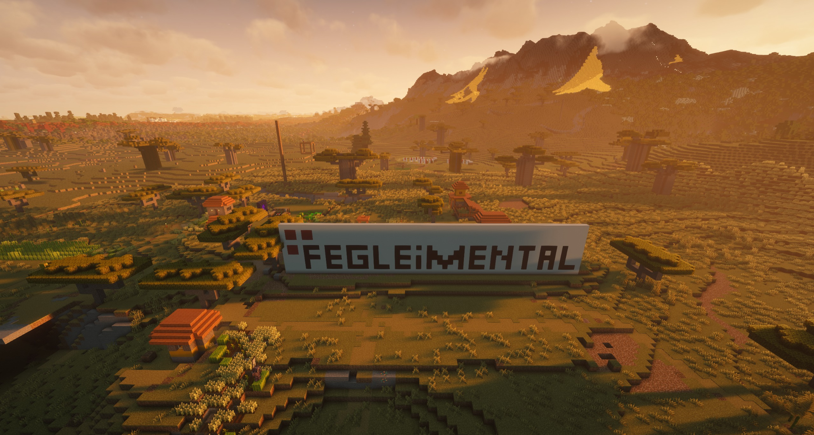
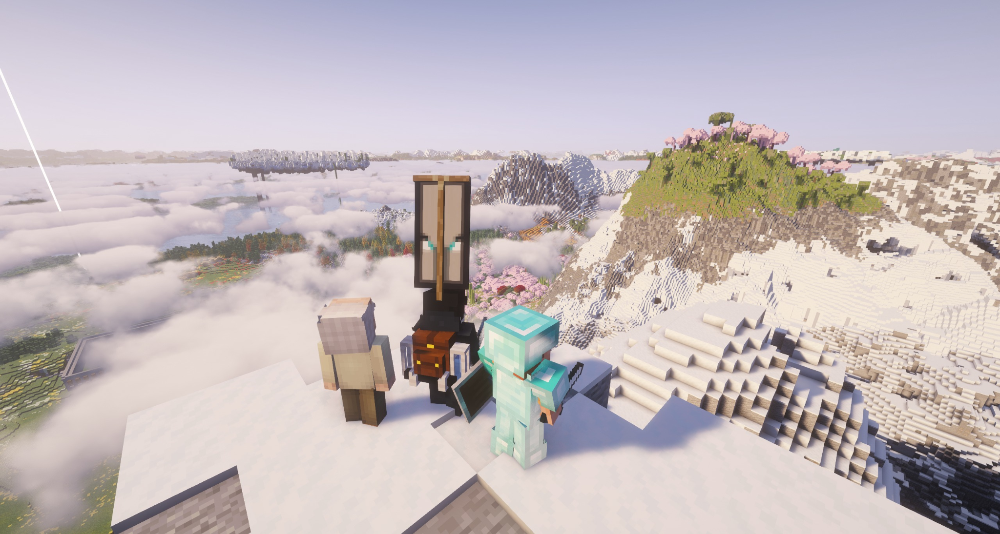
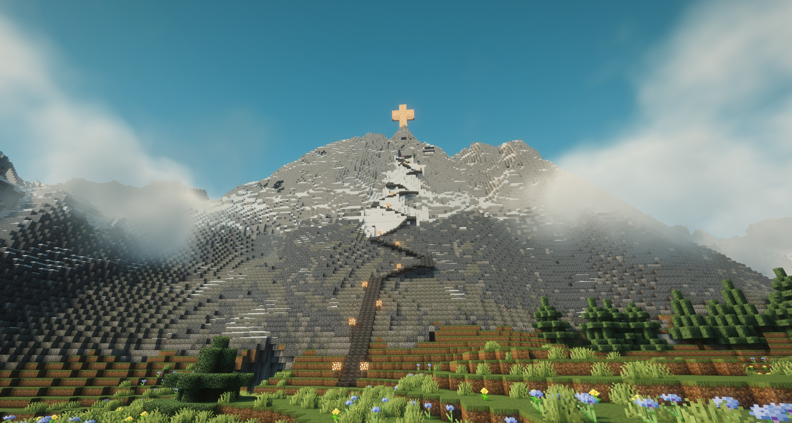
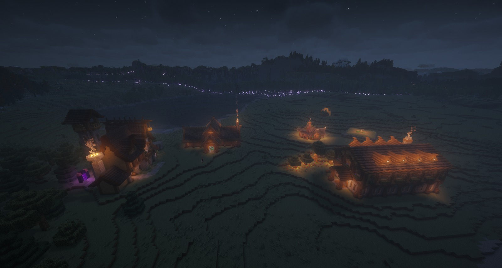
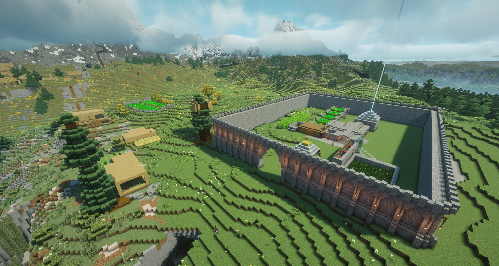

# FEGCRAFT

**A transparent, reproducible Minecraft server stack.**

FEGCRAFT is a community Minecraft server built with Fabric, Velocity and Docker. This repository documents the server configuration, mod inventory, integrations and backup workflow for maintainers and mod creators. Secrets, player data and live world files are intentionally excluded.

## At a glance

| Component | Production snapshot |
| --- | --- |
| Minecraft | 26.2, Fabric loader 0.19.5 |
| Java | Eclipse Temurin 25 |
| Proxy | Velocity via `itzg/mc-proxy` |
| Deployment | Docker Compose on Debian 13 |
| Memory | 6 GiB initial / 24 GiB maximum JVM heap |
| Performance | Lithium, C2ME, FerriteCore, ModernFix, ServerCore, spark and others |
| Backups | Existing incremental restic workflow with verification |

The information above is drawn from the November 2026 production audit. See [runtime snapshot](docs/runtime.md). This is an **infrastructure documentation starter**, not a full byte-for-byte production export yet.

## Gallery

<table><tr><td width="50%"></td><td width="50%"></td></tr><tr><td></td><td></td></tr></table>

## Get started

1. Read [deployment](docs/deployment.md) and [architecture](docs/architecture.md).
2. Export reviewed, sanitized production configuration using `scripts/export-from-server.py` on the server. It does **not** deploy or restart anything.
3. Supply your own mod JARs according to [mods/README.md](mods/README.md). Third-party JAR redistribution needs license review.
4. Configure a local `.env` and choose an actual Minecraft image/build source. The [Compose reference](compose.example.yaml) is illustrative and **not yet validated against production**.
5. Restore world data from an authorized backup and test on a separate host before any production deployment.

## Repository

| Path | Purpose |
| --- | --- |
| [`mods/`](mods/) | Observed mod JAR names, version hints and manifest generation |
| [`config/`](config/) | Example Minecraft and Velocity configuration |
| [`docker/`](docker/) | Container build requirements and provenance |
| [`backups/`](backups/) | Backup workflow documentation and placeholders for reviewed scripts |
| [`scripts/`](scripts/) | Inventory export, checksums and publication safety checks |
| [`docs/`](docs/) | Operations, setup, integrations and gallery |

## Contributing

For mod compatibility reports, include the relevant mod version, Minecraft and Fabric versions, a sanitized log excerpt and reproduction steps. Please open an issue using the provided templates. Never post credentials, access tokens, player information or world backups.

**World state is not distributed.** A new instance requires your own worlds or a separately authorized restore. The included example does not give access to the production network, Discord bot or Vector services.

## Licensing

Repository materials have no blanket license until the maintainers select one. Each third-party mod and image retains its original rights. Screenshots are supplied for this project; confirm publication and image rights before making the repository public.
